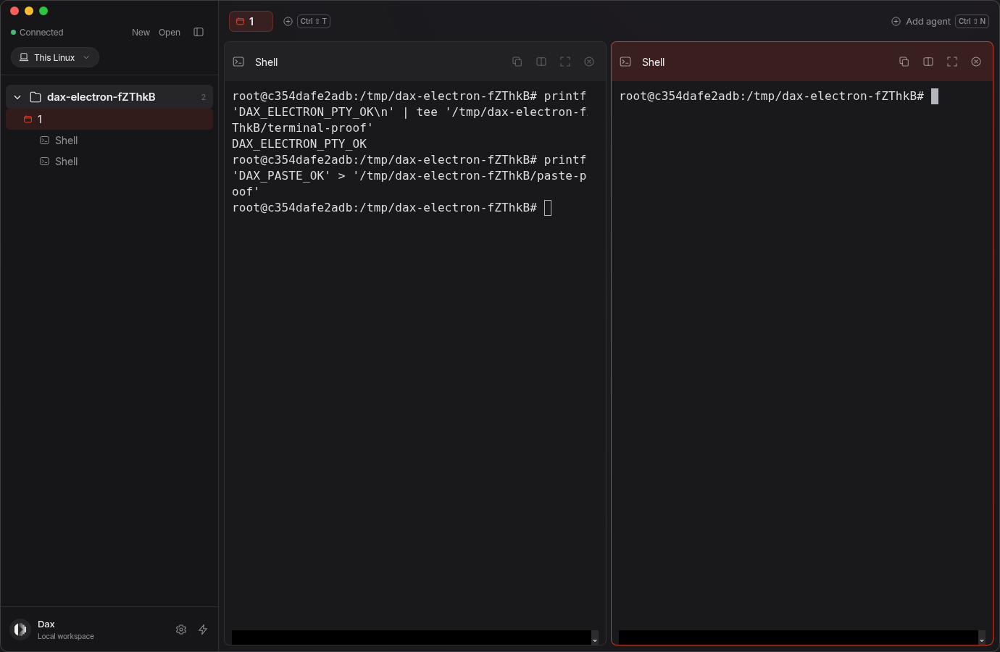
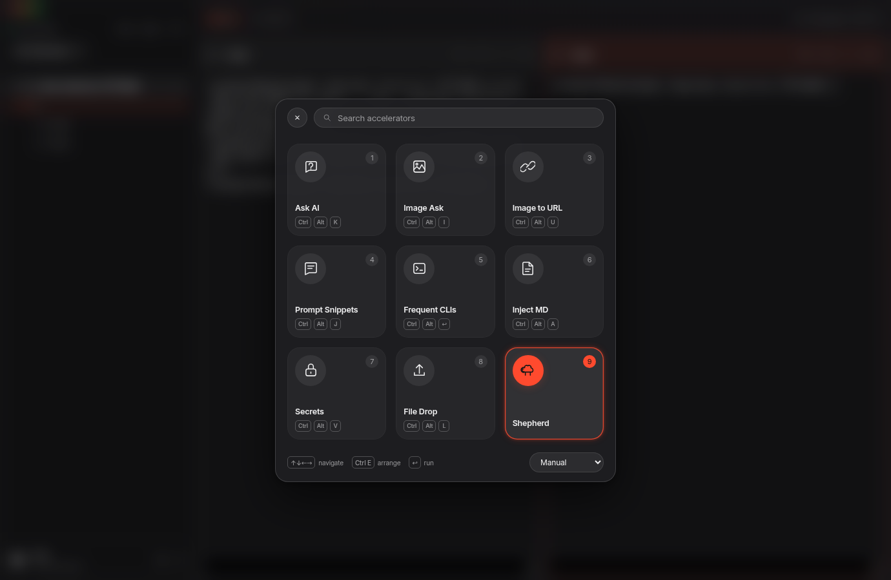
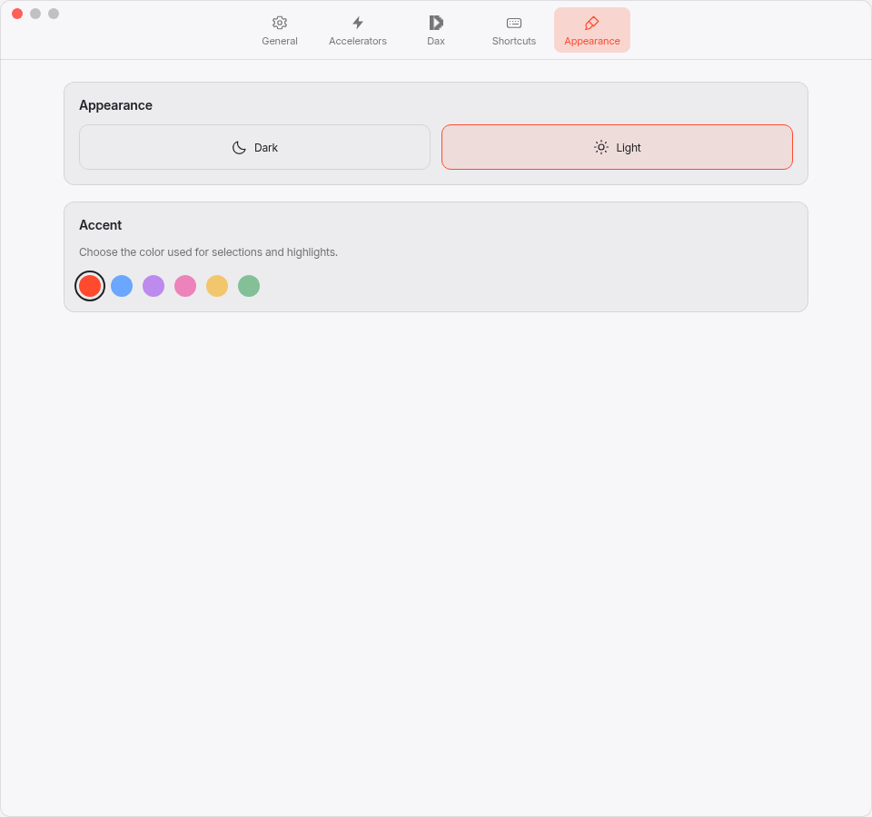

# Dax for Linux

**The human harness for working with AI agents.**

The Linux desktop now uses the macOS Dax visual design: the project sidebar,
tab strip, agent panes, floating accelerator grid, snippet previews, and Ask panel.
Settings uses its own window with the macOS icon toolbar. Dark and light
appearance share Dax's own accent and agent artwork.







## Download 0.2.0-beta.1

[Download the visual-design update](https://github.com/DaxOrg/public.linux.getdax.app/releases/tag/v0.2.0-beta.1)

**x86_64 / amd64**. Debian 12+ and Ubuntu 24.04+ are the initial package targets.
Download `dax_0.2.0-beta.1_amd64.deb`, then:

```sh
sudo apt install ./dax_0.2.0-beta.1_amd64.deb
```

A tar archive with a user-local installer is also available. See
[INSTALL.md](INSTALL.md). Existing beta-one libraries and keyring credentials
are preserved when upgrading.

## Try it

1. Open Dax and choose a project folder.
2. Add a shell, Claude Code, Codex, or Gemini CLI. Agents need to be installed and
   signed in separately.
3. Add tabs or split panes. Use the pane's expand button to focus on one agent.
4. Open **Accelerators** from the sidebar's lightning button or **Ctrl+Alt+Space**.
5. Explore Prompt Snippets, Frequent CLIs, Inject MD, Secrets, Ask AI / Image Ask,
   Image to URL, and File Drop.

**Ctrl+Shift+K** finds a project. **Ctrl+Shift+J** jumps to an agent. **Ctrl+Shift+N** adds an
agent, **Ctrl+Shift+T** creates a tab, **Ctrl+Shift+B** folds the sidebar, and
**Ctrl+Shift+C/V** copies/pastes terminal text. Escape closes a palette or returns
to its launcher. A global launcher shortcut can be enabled in Settings.

Local features need no Dax account. AI requires a Dax invite code or your
OpenRouter key. File uploads require Dax and are limited to 64 MB in this beta.
SSH uses your normal OpenSSH configuration and keys.

## Visual design and current limits

The launcher, snippet panel, Ask panel, surfaces, typography sizes, and pane chrome
follow the macOS source measurements. The Linux interface uses bundled Inter;
font rasterization, native file dialogs, and desktop-compositor blur can vary.
This is not full macOS feature parity: multiplayer, image generation, background
removal, screen markup, remote snippet-library synchronization, custom cloud
storage, and terminal-process restoration are not yet included.

Prompt Snippets includes Dax's bundled Preloader Snippet. **Type** pastes into an
open Shepherd terminal; **Copy** works with any application. Commands and agents
are never automatically relaunched after quitting.

Wayland portal availability depends on the desktop. Interactive GNOME/KDE/Wayland
coverage and live account-backed AI/upload tests remain areas for broader beta
testing. No ARM64 package or automatic updater yet.

## Privacy

Libraries and project paths stay on this computer. Credentials use GNOME Keyring
or KDE Wallet. No clipboard polling or automatic analytics. Ask sends the
conversation and selected image only when you press Send. Uploads send only the
file you explicitly choose to upload. **Anyone with the returned link can access
that uploaded file.** Coding agents manage their own connections and permissions.

[Validation record](VALIDATION.md)

## Feedback

[Report an issue](https://github.com/DaxOrg/public.linux.getdax.app/issues/new).
Include your distribution, desktop, X11/Wayland, Dax version, and reproduction
steps. Remove private prompts and credentials from any logs you share.
